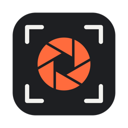
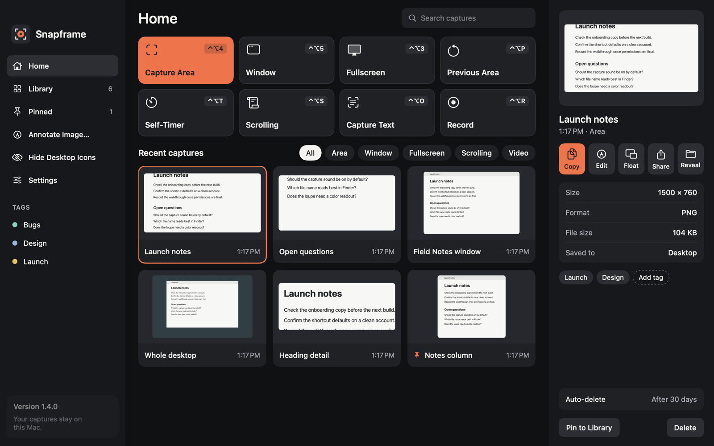
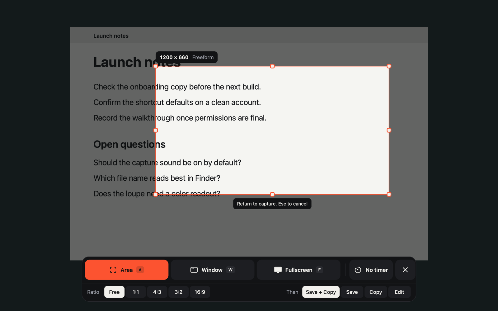
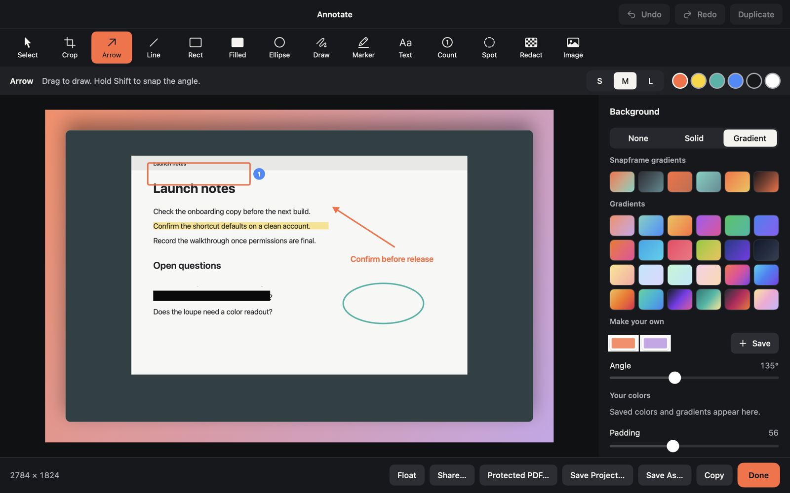
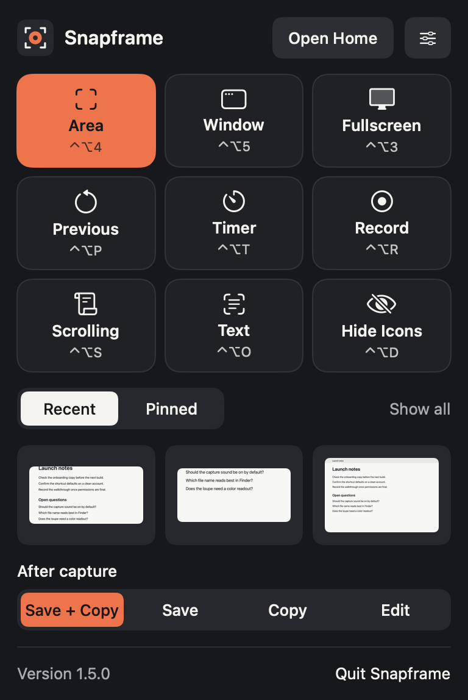
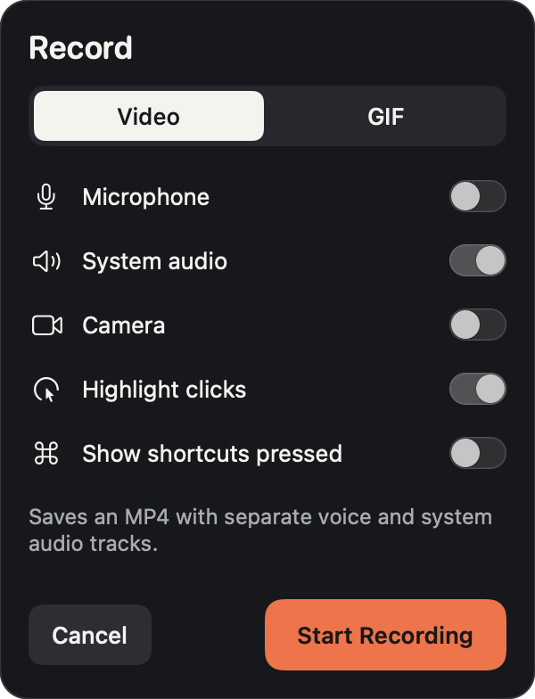
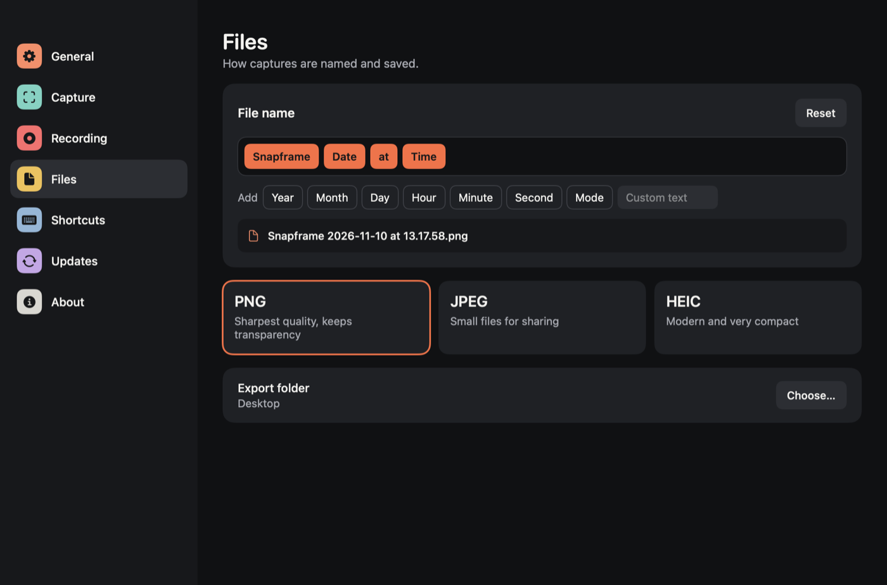
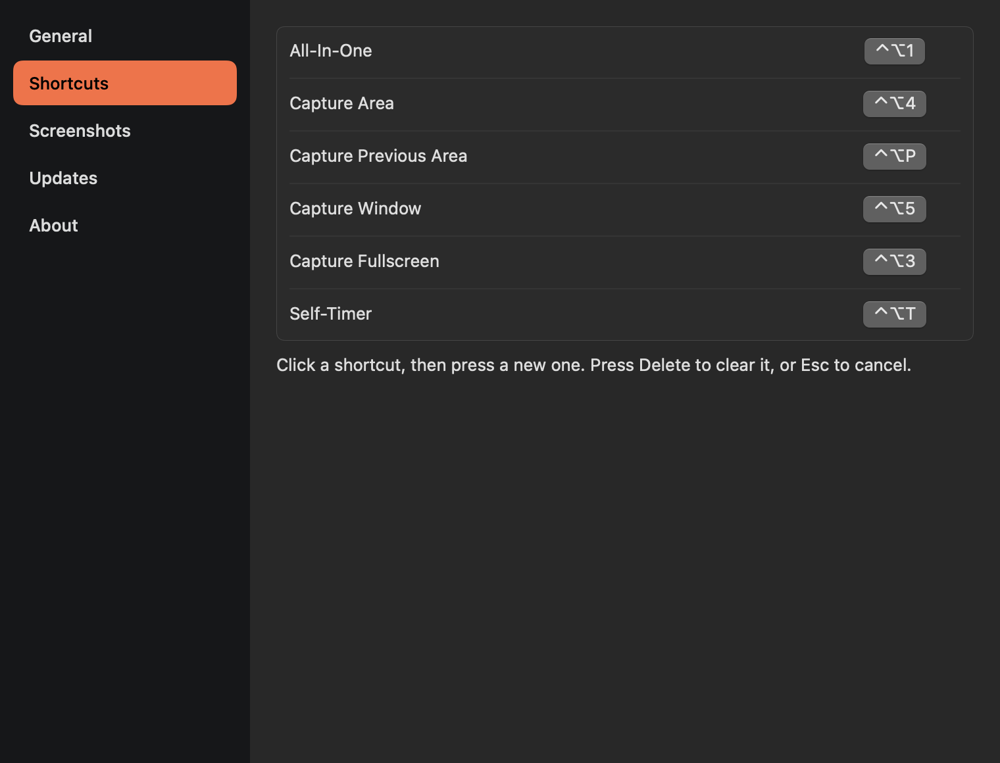
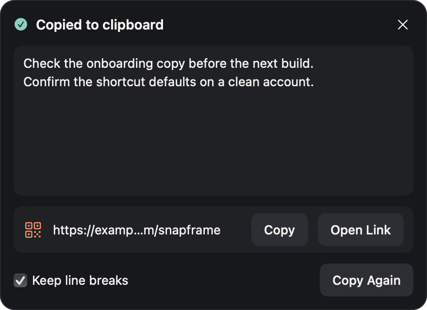
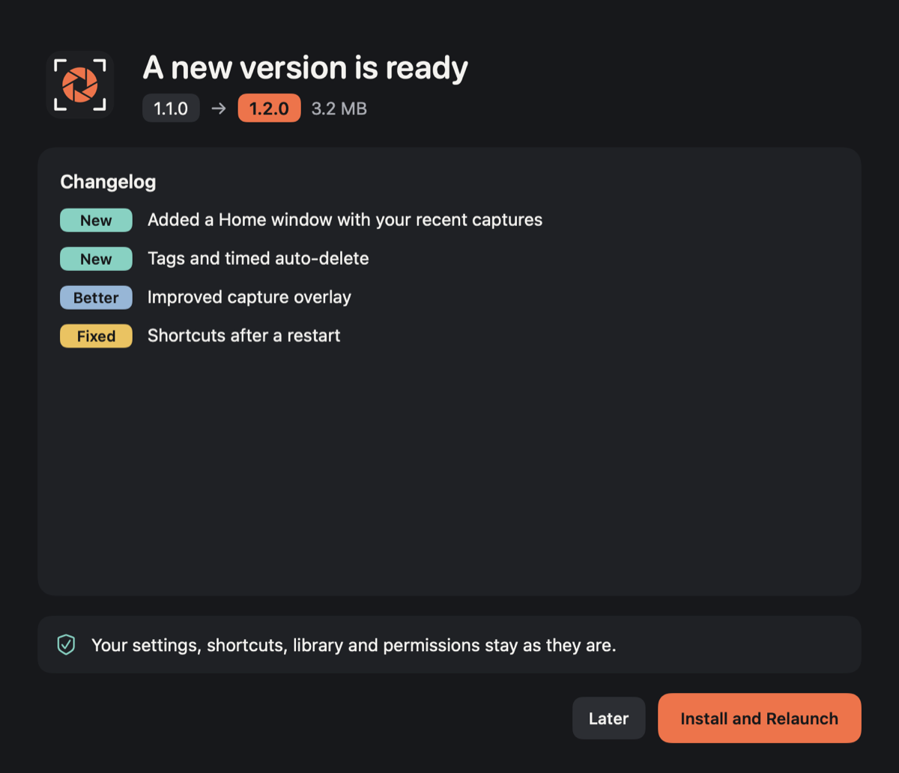

<div align="center">



# Snapframe

**Screenshots, screen recording and markup for your Mac. Free, and private by design.**

[](https://github.com/sagarrokade006/snapframe/releases/latest)   

[**Download the latest version**](https://github.com/sagarrokade006/snapframe/releases/latest)&nbsp;&nbsp;·&nbsp;&nbsp;[Features](#features)&nbsp;&nbsp;·&nbsp;&nbsp;[Install](#install)&nbsp;&nbsp;·&nbsp;&nbsp;[Shortcuts](#keyboard-shortcuts)&nbsp;&nbsp;·&nbsp;&nbsp;[Privacy](#privacy)

<br>



</div>

## Why Snapframe

- **Every feature is free.** There are no tiers, subscriptions or licenses.
- **Your captures stay on your Mac.** There are no accounts, uploads or online models.
- **It stays out of the way.** Snapframe lives in the menu bar and is one shortcut away.

## Features

### Capture

| Feature | What it does |
|---|---|
| **Area, window and fullscreen** | Capture any of them, repeat your previous area, or use a self-timer |
| **Precise selection** | Freeze the screen, snap to window edges, lock an aspect ratio, and use a loupe with a color readout |
| **Scrolling capture** | Stitch long pages into one image, skipping sidebars and fixed bars |
| **Text recognition** | Copy text from anything on screen, processed entirely on your Mac |
| **QR codes** | Read a code from your screen, and choose whether to open its link |
| **Clean desktop** | Hide desktop icons on demand, or only while capturing |

<div align="center">

</div>

### Annotate

| Feature | What it does |
|---|---|
| **14 tools** | Crop, arrows, lines, shapes, drawing, marker, text, numbered counters, spotlight, redaction and images |
| **Backgrounds** | Colors, gradients, padding, rounded corners and shadow |
| **Stay editable** | Undo and redo freely, reopen your markup later, or save a `.snapframe` project |
| **Safe redaction** | Redacted pixels are permanently removed when you save an edit or project |
| **Share your way** | Copy, float above other windows, use the macOS share sheet, or export a password-protected PDF |

<div align="center">

</div>

### Record

| Feature | What it does |
|---|---|
| **MP4 or GIF** | Record your whole screen or any area, at up to 60 frames per second |
| **Separate audio tracks** | Microphone and system audio are kept apart for easier editing |
| **On-screen helpers** | Webcam bubble, click highlights and a display of shortcuts you press |
| **Full control** | Pause, resume, restart or discard from a small control bar |
| **Never lose a take** | Recordings are recovered automatically after a crash or forced quit |
| **Trim** | Cut the start and end from Home or the preview card |

### Organize

| Feature | What it does |
|---|---|
| **Home and library** | Browse, search and filter everything you've captured |
| **Tags and pins** | Group captures with tags, and pin the ones to keep |
| **Auto-delete** | Clear older library copies after a period you choose |
| **Preview card** | Copy, edit, float or reveal a capture the moment you take it |
| **Custom file names** | Build names from the date, time and capture type |

## Screenshots

<table>
  <tr>
    <td align="center" width="50%"><br><sub><b>Menu bar</b></sub></td>
    <td align="center" width="50%"><br><sub><b>Recording options</b></sub></td>
  </tr>
  <tr>
    <td align="center"><br><sub><b>File name builder</b></sub></td>
    <td align="center"><br><sub><b>Shortcuts</b></sub></td>
  </tr>
  <tr>
    <td align="center"><br><sub><b>Text and QR codes</b></sub></td>
    <td align="center"><br><sub><b>In-app updates</b></sub></td>
  </tr>
</table>

## Install

1. Download the DMG from the [latest release](https://github.com/sagarrokade006/snapframe/releases/latest).
2. Open it and drag **Snapframe** to Applications.
3. Open Snapframe. macOS blocks the first launch because the app isn't notarized.
4. Go to **System Settings > Privacy & Security** and choose **Open Anyway**.
5. Follow the short setup, and allow Screen Recording when asked.

Snapframe has no Dock icon. Look for it in the menu bar, or open the app again to bring up Home.

**Requirements:** macOS 14 or later, on Apple silicon or Intel.

### Updating

Snapframe checks for new versions when it starts. You'll see the changelog and choose when to install, and your settings, shortcuts, library and permissions stay as they are.

## Keyboard shortcuts

| Action | Shortcut | | Action | Shortcut |
|---|---|---|---|---|
| Capture Area | <kbd>⌃</kbd> <kbd>⌥</kbd> <kbd>4</kbd> | | Scrolling Capture | <kbd>⌃</kbd> <kbd>⌥</kbd> <kbd>S</kbd> |
| Capture Window | <kbd>⌃</kbd> <kbd>⌥</kbd> <kbd>5</kbd> | | Capture Text | <kbd>⌃</kbd> <kbd>⌥</kbd> <kbd>O</kbd> |
| Capture Fullscreen | <kbd>⌃</kbd> <kbd>⌥</kbd> <kbd>3</kbd> | | Record Screen | <kbd>⌃</kbd> <kbd>⌥</kbd> <kbd>R</kbd> |
| Previous Area | <kbd>⌃</kbd> <kbd>⌥</kbd> <kbd>P</kbd> | | Hide Desktop Icons | <kbd>⌃</kbd> <kbd>⌥</kbd> <kbd>D</kbd> |
| Self-Timer | <kbd>⌃</kbd> <kbd>⌥</kbd> <kbd>T</kbd> | | All-In-One | <kbd>⌃</kbd> <kbd>⌥</kbd> <kbd>1</kbd> |

You can change any of them in Settings.

<details>
<summary><b>Shortcuts inside the capture overlay</b></summary>

<br>

| Key | Action |
|---|---|
| <kbd>A</kbd> <kbd>W</kbd> <kbd>F</kbd> <kbd>S</kbd> <kbd>O</kbd> <kbd>R</kbd> | Switch between Area, Window, Fullscreen, Scrolling, Text and Record |
| <kbd>T</kbd> | Cycle the self-timer |
| <kbd>Return</kbd> | Confirm |
| <kbd>Esc</kbd> | Cancel |
| Hold <kbd>Shift</kbd> | Select a square, or include the wallpaper with a window |
| Hold <kbd>Control</kbd> | Copy without saving |
| Hold <kbd>Command</kbd> | Turn off edge snapping |
| <kbd>⌘</kbd> <kbd>C</kbd> | Copy the color under the cursor |

</details>

<details>
<summary><b>Automation with <code>snapframe://</code> links</b></summary>

<br>

Scripts and launchers can control Snapframe with links. Snapframe asks first, and you can change that in **Settings > General**.

| Link | Action |
|---|---|
| `snapframe://capture-area` | Select an area |
| `snapframe://capture-area?x=100&y=100&width=800&height=600&display=0` | Capture an exact area |
| `snapframe://capture-window` | Capture a window |
| `snapframe://capture-fullscreen` | Capture the screen |
| `snapframe://capture-previous-area` | Capture the previous area |
| `snapframe://self-timer` | Start the self-timer |
| `snapframe://all-in-one` | Open the capture overlay |
| `snapframe://scrolling-capture` | Start a scrolling capture |
| `snapframe://capture-text` | Recognize text |
| `snapframe://record-screen` | Start a recording |
| `snapframe://hide-desktop-icons` | Hide desktop icons |
| `snapframe://show-desktop-icons` | Show desktop icons |
| `snapframe://toggle-desktop-icons` | Switch desktop icons on or off |
| `snapframe://open-home` | Open Home |
| `snapframe://open-settings` | Open Settings |

</details>

## Privacy

Snapframe has no accounts, uploads, online models, analytics or crash reporting.

| Area | How it's handled |
|---|---|
| **Network** | Its only network use is checking GitHub for app updates |
| **Screen Recording** | Required by macOS for any screen capture |
| **Microphone and camera** | Used only during recordings where you turn them on |
| **Accessibility** | Optional, and only needed to show shortcuts you press while recording. Ordinary typing is never shown |
| **Your captures** | Saved to the folder you choose, with a private library copy on your Mac |

## Roadmap

- [x] Capture, overlay and shortcuts
- [x] Annotate editor and capture library
- [x] Scrolling capture, text recognition and automation
- [x] Screen recording, GIFs and trim
- [ ] **Studio:** a timeline editor with automatic zoom and a restyled cursor

## Build from source

You'll need Xcode 16 or later.

```bash
git clone https://github.com/sagarrokade006/snapframe.git
cd snapframe
swift build
swift test
```
